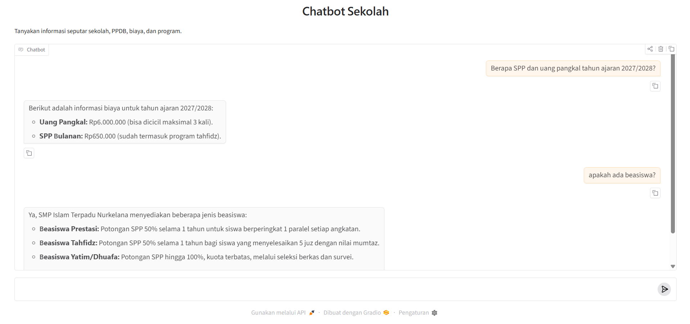

# Chatbot Sekolah

Chatbot tanya jawab untuk orang tua, siswa, dan calon pendaftar. Bot menjawab dalam Bahasa Indonesia, hanya berdasarkan isi `data-sekolah.txt`. Kalau informasinya tidak ada di data, bot mengarahkan penanya ke TU sekolah dan tidak mengarang jawaban.

Model yang dipakai adalah Qwen, dijalankan lokal lewat Ollama atau di cloud lewat Alibaba Cloud Model Studio (DashScope). Tersedia dua tampilan: web (Gradio) dan terminal.



> **Catatan:** isi `data-sekolah.txt` saat ini adalah contoh fiktif. Ganti dengan data asli sekolah sebelum chatbot dipakai.

## Cara kerja

Seluruh isi `data-sekolah.txt` dimasukkan ke system prompt saat program dimulai, lalu model diminta menjawab hanya dari data itu. Cara ini cocok untuk data beberapa halaman. Kalau datanya sudah puluhan halaman, sebaiknya beralih ke RAG (vector database).

Bot mengingat 10 pesan terakhir dalam satu percakapan.

## Struktur proyek

| File | Fungsi |
|---|---|
| `app.py` | Tampilan web Gradio |
| `chatbot.py` | Logika chatbot, pilihan backend, dan tampilan terminal |
| `data-sekolah.txt` | Data sekolah yang menjadi sumber jawaban |

## Instalasi

Butuh Python 3. Install dependensinya:

```bash
pip install gradio openai
```

Untuk versi terminal saja, `pip install openai` sudah cukup.

### Backend Ollama (bawaan)

Gratis, dan data tidak keluar dari laptop.

1. Install [Ollama](https://ollama.com) dan pastikan sudah berjalan.
2. Unduh modelnya:

   ```bash
   ollama pull qwen3.5:4b
   ```

Model `qwen3.5:4b` cocok untuk laptop RAM 8 GB. Untuk RAM 16 GB, pakai `qwen3.5:8b` dan set `MODEL` seperti di bagian [Konfigurasi](#konfigurasi).

### Backend DashScope

Berbayar, tetapi modelnya lebih besar. Pesan pengguna dan data sekolah dikirim ke server Alibaba Cloud. Buat API key di Model Studio, lalu set environment variable (contoh PowerShell):

```powershell
$env:BACKEND = "dashscope"
$env:DASHSCOPE_API_KEY = "api-key-anda"
```

## Menjalankan

Tampilan web:

```bash
python app.py
```

Lalu buka <http://127.0.0.1:7860>.

Tampilan terminal:

```bash
python chatbot.py
```

Ketik `keluar`, `exit`, atau `quit` untuk berhenti.

## Konfigurasi

| Environment variable | Bawaan | Keterangan |
|---|---|---|
| `BACKEND` | `ollama` | `ollama` atau `dashscope` |
| `MODEL` | `qwen3.5:4b` (Ollama), `qwen-plus` (DashScope) | Nama model yang dipakai |
| `DASHSCOPE_API_KEY` | - | Wajib kalau memakai backend DashScope |

## Memperbarui data sekolah

1. Edit `data-sekolah.txt`. Tulis fakta saja, singkat, satu informasi per baris.
2. Perbarui tanggal "Terakhir diperbarui" di bagian atas file.
3. Mulai ulang program, karena data hanya dibaca sekali saat program dimulai.

## Mengatasi masalah

| Pesan | Solusi |
|---|---|
| Tidak bisa terhubung ke Ollama | Pastikan Ollama berjalan. Cek <http://localhost:11434> |
| Model belum diunduh | Jalankan `ollama pull <nama-model>` |
| `KeyError: 'DASHSCOPE_API_KEY'` | Set `DASHSCOPE_API_KEY` sebelum menjalankan program |
